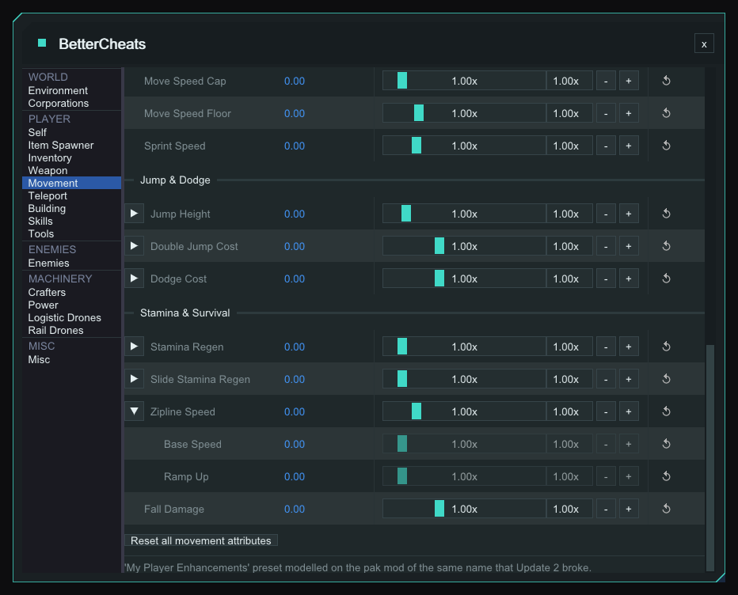
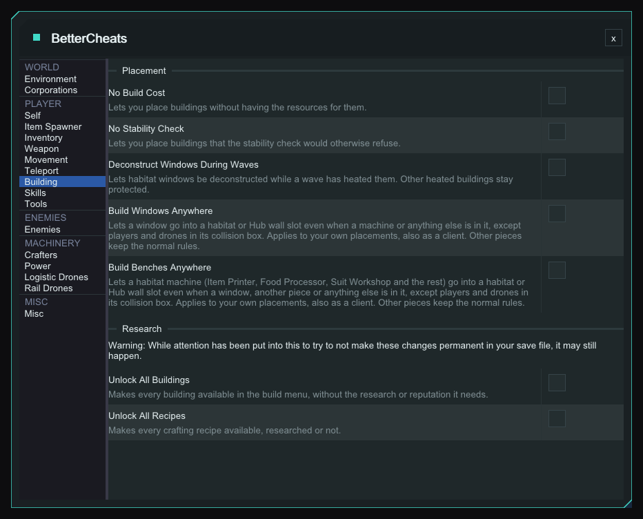

# BetterCheats -- StarRupture Plugin

In-game cheat menu for [StarRupture](https://store.steampowered.com/app/1631270/StarRupture/), built on the StarRupture ModLoader. Settings are saved per save.

**Target:** Game client only

---

## What It Does

**F10** opens the window, **Esc** or **Q** closes it (not rebindable). The pages work only in a `ChimeraMain` world, single player or with `EnableCheatsInMultiplayer` on; elsewhere the window says so. Locks and overrides are enforced every engine tick, menu open or not. Power edits are applied on Apply and on save load.

| Group | Pages |
|---|---|
| World | Environment, Corporations |
| Player | Self, Item Spawner, Inventory, Weapon, Movement, Teleport, Building, Skills, Tools |
| Enemies | Enemies |
| Machinery | Crafters, Power, Logistic Drones, Rail Drones |
| Misc | Misc |

Teleport, Crafters, Rail Drones and Misc are empty placeholders. Logistic Drones points to `BetterDrone.ini`.

**Rows.** Most settings are one row: label, live value (what the game uses now; red when it differs from your setting; **+buff** tag and a Base / Mods / Ours / Result tooltip), slider, typed box, **-/+**, reset icon. A value that differs from its default is applied; reset turns it off. Multipliers act on base stats, attachments and buffs still add on top.

### Saved Presets <a href="https://github.com/msantoro12"></a>

A **Saved Presets** row sits on Power, Self, Inventory, Movement, Skills, Tools and each weapon tab. Pick one to load it. **Save** stores that page's settings (Inventory: Item Stack Sizes only) as `<built-in> Custom` or `Custom` (made unique), **Rename**, **Delete** (asks first). Up to 16 are listed per page; built-in names are reserved. Stored in `Plugins\config\BetterCheats-Presets.ini`, shared by every save.

---

## World

### Environment

Wave Status shows Type, Stage (**Skip** during a wave) and a progress bar.

| Control | Does |
|---|---|
| Start Wave: **Heat** | Starts a heat wave |
| **Pause** / **Resume** | The wave in progress |
| **Cancel** | Ends the wave in progress, resets the Next Wave countdown and re-enables waves |
| Pause Waves: **Pause** / **Unpause** | Pins the wave timer so the next wave never arrives, menu open or not |
| **Restart** | Re-arms the Next Wave countdown and re-enables waves. For a rupture that never arrives after loading a save. The Next Wave readout shows m:ss, or the wave, disabled or stalled state |
| **Enable** / **Disable** | Wave spawn timer on or off (saved with the game) |

### Corporations

**Data Points** box (0 or more) and **Apply**. Stored in the save, so it stays even if BetterCheats is removed.

---

## Player

### Self

Tick **Locked** and an attribute is held at its slider value, even with the menu closed. Locks and Max Health are saved per save.

| Group | Rows | Button |
|---|---|---|
| Health | Health | **Full Heal** |
| Max Health | Number box (step 10 / 100) | **Set** (Max and current Health) |
| Survival Resources | Energy, Shield, Hydration, Calories, Oxygen | **Fill** |
| Afflictions | Toxicity, Radiation, Heat, Drain, Corrosion, Infection, Temperature | **Clear** |

### Item Spawner

Search the item list (icon, name, stack size), set **Stacks** (1 or more), press **Give Item**. You get stacks x stack size, shown as `xN (stack S)`.

### Inventory

**Grid.** Any **Columns x Rows** from 8 x 8 to 40 x 40, also via `bc_invsize`. The game won't shrink below slots in use, so empty it first. **Shrink slots to fit the inventory frame** (on by default) scales slots against 8 x 8 (100%): 16 x 16 is 50%, 20 x 20 is 40%, the floor. The frame doesn't scroll, so larger grids overflow. Current grid, Reference grid and Slot size are shown. Saved per save.

#### Plant Pickup <a href="https://github.com/msantoro12"></a>

Whole-number multiplier, 1x to 5x (default 1x), on what a wild plant, mushroom or rock gives when picked up. Crops (regrowing bushes) are not covered.

#### Item Stack Sizes <a href="https://github.com/msantoro12"></a>

Raises stack caps for new stacks only; existing stacks keep their cap until picked up, split or merged. Raise-only: an item that already stacks higher keeps its size. Non-stacking items are shown but locked. Item beats category beats global.

| Row | Range |
|---|---|
| Stack size (global) | 1-9999 (1 = off) |
| Category | 1-9999: Combat, Resource, Consumable, Story Item, Alien Item, Valuable, Gem (Movement / Combat / Survival), Uncategorized, Empty Item, Blueprint Item, Other |
| Item | stock size-9999. Search box, **Only show changed** |

### Weapon <a href="https://github.com/msantoro12"></a>

Tabs: **Pistol**, **Rifle**, **Shotgun**, **Machine Gun**; any other weapon or grenade gets a tab when first equipped. Live values show the weapon in your hand, other tabs an estimate.

| Ammo option (all weapons) | Does |
|---|---|
| Infinite clip - ALL weapons | Clip stays full: no reload, reserve never drawn |
| Keep ammo stocked | Tops up the equipped weapon's own ammo type with the shortfall. You still reload |
| Keep it out of my inventory | Default on. Stocks the hidden inventory, no slot used. Untick if reloads can't draw from it |
| Clips to keep in reserve | 1-100, default 3 |

A live line shows `clip x/y reserve x/y` and `[restocking]`. Each tab also shows the weapon's stock damage, rounds/min, magazine and range.

Per weapon: **One Hit Kill** (flat 10000x damage, replaces Damage), **Infinite magazine**, **Reset this weapon to stock**, plus the preset buttons below. The asset name is shown beside Reset.

| Row | Range | Default |
|---|---|---|
| Damage | 0.10-25x | 1.00x |
| Fire Rate, Reload Speed, Damage Falloff, ADS Speed | 0.10-5x | 1.00x |
| Recoil, Spread, Sway | 0-3x | 1.00x |
| Magazine Size | -100 to +999 (flat) | 0 |
| Enemies Hit / Shot | 1-10 (whole) | 1 |

| Preset | Sets |
|---|---|
| Better Weapons (all) | Damage 1.5, Fire Rate 1.25, Reload 1.5, Magazine +15, Falloff 1.5, Hit 2 |
| Hand Cannon (pistol) | Damage 4, Fire Rate 0.45, Recoil 1.8, Magazine -4, Falloff 1.5, Hit 3 |
| Piercing | Enemies Hit 3 |
| Laser Beam | Recoil, Spread, Sway 0 |
| Bullet Hose | Fire Rate 3, Magazine +100, Reload 2.5, Spread 0.6 |

**Grenade tabs** replace those rows. **Infinite charges** tops the count up to max. Damage can't be changed here (see `bc_grenadedmg`). Preset **Less Cost Grenade**: Charge Cost 0.5.

| Row | Range | Default |
|---|---|---|
| Charge Cost | 0-2x | 1.00x |
| Max Charges | 0-20 (0 = game default) | 0 |
| Min Charge | 0-5 | 0 |
| Fuse Time * | 0.05-5x | 1.00x |
| Blast Radius * | 0.10-5x | 1.00x |
| Throw Force * | 0.10-5x | 1.00x |

\* Shared by every grenade type (**Blast** section), not reset by **Reset this weapon**.

Better Weapons, Hand Cannon, Piercing and Less Cost Grenade are modelled on pak mods Update 2 broke: Better Weapons and Less Cost Grenade by axbhub, Hand Cannon and Piercing by SwiftstepsKR.

### Movement

Fly mode (**No Clip**) puts the character in flight; **Space** rises, **Left** or **Right Ctrl** descends (ignored while the menu is open or the game is in the background).

| Control | Does |
|---|---|
| **Fly Mode Toggle:** Active | Fly on or off |
| **Hotkey:** | Click, press a key, Esc cancels. Ctrl, Shift, Alt combos work; no mouse buttons. **Reset** returns F9 |
| Pass Through Walls (Clipping) | Default on. Collision off, with a flashing red warning: turning Fly off inside terrain drops you through the world. Off keeps collision and shows a note that Fly is safe to toggle |
| Fly Speed Multiplier | 1.0-25.0x, default 3.0x. A Top speed line shows km/h, mph and cm/s |



Blue column: live value in game (0.00 in this shot).

#### Tuning rows and presets <a href="https://github.com/msantoro12"></a>

A live line shows MaxWalkSpeed, horizontal speed, JumpZVelocity and stamina. Each row below defaults to 1.00x; an arrow opens finer rows. The top rows cascade into their finer rows (Move Speed into the four gait speeds, Zipline Speed into Base Speed); each stays editable after. Finer rows stay greyed until the stock values are read (load a save); the baseline is captured once and saved per save. **Reset all movement attributes** clears everything.

| Group | Row (range) | Finer rows (range) |
|---|---|---|
| Speed | Move Speed (0.10-10) | Walk, Sprint, Crouch, Aiming (0.10-10) |
| Speed | Acceleration (0.10-20) | Max Acceleration (0.10-20), Sprint Ramp Time, Ground Friction, Braking (0-5) |
| Speed | Move Speed Cap (0.10-10), Move Speed Floor (0-5), Sprint Speed (0.10-5) | |
| Jump & Dodge | Jump Height (0.10-8) | Jump Velocity (0.10-10), Gravity Scale (0-5), Coyote Time (0-20), Step Height (0.10-20), Jump Energy Cost (0-3) |
| Jump & Dodge | Double Jump Cost (0-3) | Double Jump Energy (0-3) |
| Jump & Dodge | Dodge Cost (0-3) | Dash Distance (0.10-10), Dash Duration (0.10-5), Dash Cooldown (0-3), Dash Energy Cost (0-3), Max Air Dashes (1-20), Air Control (0-20), Air Friction (0-5) |
| Stamina & Survival | Stamina Regen (0.10-10) | Regen Rate (0.10-20), Regen Delay (0-3), Sprint Drain (0-3), Max Energy (0.10-20) |
| Stamina & Survival | Slide Stamina Regen (0.10-10) | Max Slide Speed (0.10-10), Slide Impulse (0.10-10), Slide Gravity (0-5), Slide Friction (0-5) |
| Stamina & Survival | Zipline Speed (0.10-5) | Base Speed (0.10-10), Ramp Up (0.10-10) |
| Stamina & Survival | Fall Damage (0-3; 0 removes) | |

Move Speed Cap and Floor are set directly, not multiplied.

| Preset | Sets |
|---|---|
| My Player Enhancements | Move Speed and Sprint 1.25, Jump Height 1.35, Dodge Cost 0.5, Stamina and Slide Regen 1.75; finer rows: Walk and Sprint 1.25, Jump Velocity 1.35, Max Slide Speed 1.25, Regen Rate 1.75, Dash Cooldown 0.6 |
| Sonic Mode | Move Speed, Cap and Sprint 5, Zipline 3; Crouch 3, Acceleration 3, Max Acceleration 3, Sprint Ramp Time 0.1 |
| Moon Hop | Fall Damage 0, Jump Height 4, Double Jump Cost 0.05; Gravity 0.2, Jump Velocity 2.5, Air Control 4, Air Friction 0.3, Double Jump Energy 0.05 |
| Endless Momentum | Dodge Cost and Double Jump Cost 0.05, Stamina and Slide Regen 8; Dash, Jump and Double Jump Energy 0.05, Dash Cooldown 0, Regen Rate 8, Regen Delay 0, Sprint Drain 0 |

My Player Enhancements recreates the pak mod of the same name that Update 2 broke.

### Building

Off by default, saved per save, with a description under each title.



| Option | Does |
|---|---|
| **No Build Cost** | Place buildings without the resources |
| **No Stability Check** | Place buildings the stability check would refuse, including zoop and dynamic pillars |
| **Unlock All Buildings** | Research: unlocks every building |
| **Unlock All Recipes** | Research: unlocks every recipe |

The Research options sit under a warning that changes may still end up in your save.

- **Deconstruct Windows During Waves**: lets any of the four window pieces be deconstructed while a wave has heated it. Other heated buildings stay protected. <a href="https://github.com/msantoro12"></a>
- **Build Windows Anywhere**: puts a window into a habitat or Hub wall slot even when a machine or other building is in it. <a href="https://github.com/msantoro12"></a>
- **Build Benches Anywhere**: does the same for Analyzer, Armory, Cloning Bed, Food Processor, Item Printer, Recipe Table, Recycler, Research Terminal, Suit Workshop and Upgrade Station. The game only records that a slot is taken, so a bench can also go into a slot holding a window, airlock, bridge or personal storage. <a href="https://github.com/msantoro12"></a>

The two "anywhere" options relax only the collision check for the piece you place, so the ghost goes green. Your own placements only; in multiplayer they need `EnableCheatsInMultiplayer`. Still refused:

- a player or drone in the collision box;
- a window not snapped to a habitat or the Hub, or into a slot already holding a window, airlock or bridge;
- anything checked separately: stability (unless **No Stability Check** is on), sockets, base-core areas, terrain, resources.

Creatures, characters and plants in the volume are let through only when a building is also there.

### Skills

**Max All Skills** sets level 999, XP 0. **Per-Skill Overrides** sliders 0-100 for Movement, Combat and Survival. Written to the save, so it stays even if BetterCheats is removed.

### Tools

| Option | Does |
|---|---|
| **One Hit Kill Laser** | Flat 10000 mining damage, overrides Mining Damage |
| **No Handheld Drill Overheat** | Handheld drill never heats |

No Handheld Drill Overheat holds the game's own heat-immunity tag while on; a drill that is already hot cools normally. The tag comes off when you switch it off, the world ends or the plugin unloads (loader 1.22.0 or newer; an older loader leaves it on until you respawn).

#### Mining Power <a href="https://github.com/msantoro12"></a>

| Row | Range (default 1.00x) |
|---|---|
| Mining Damage | 0.10-25 |
| Weak Spot Multiplier | 0.10-10 |
| Enemy Damage | 0.10-25 |
| Range | 0.50-5 |
| Hit Rate | 0.25-5 |
| Aggro | 0-2 |
| Overheat Cooldown | 0.05-5 (lower cools faster) |
| Mining Boost | 0.10-10 (raises the max too) |

Values are estimated until the mining tool is equipped. A Tools Saved Presets row also stores both toggles and Mining Boost. Presets are modelled on Better Mining Tool by astroboy314 (Nexus Mods #105):

| Preset | Mining Damage | Enemy Damage | Range | Hit Rate | Aggro |
|---|---|---|---|---|---|
| Better Mining | 2.5 | 1.2 | 1.14 | 1.25 | 0.5 |
| Better Mining OP | 4 | 2 | 1.43 | 1.25 | 0.25 |

---

## Enemies

| Option | Does |
|---|---|
| **Disable AI** | Stops behaviour-tree ticking and zeroes attack range, so enemies never land a hit |
| **One-Hit Kill** | Pins every tracked enemy's health to 1, so any hit finishes them |

The page shows "Tracking N active enemies." Both are saved per save.

---

## Machinery

### Power

Two tables, Producers and Consumers: a number box, **Apply** and a reset arrow per building (the tooltip shows the default). Apply updates the template for new buildings and patches placed ones. **Rescan** and **Reset All** sit on top. Saved per save and re-applied by a rescan on load.

---

## Console

Mod console commands:

- `bc_invsize <columns> <rows>` (alias `invsize`) resizes the inventory grid, clamped 8-40. No arguments prints the current grid.
- `bc_grenadedmg [scale]`: multiplies the equipped grenade's base damage (a test probe). Scale 0-100, `1` (default) is unchanged; no argument prints it. Applies while a grenade is equipped, restored on switching grenades, unload and RELOAD (loader 1.22.0 or newer). Not saved. <a href="https://github.com/msantoro12"></a>

---

## Per-save settings

Toggles, locks and values are saved to `Plugins\BetterCheats\<SessionName>.json` (illegal filename characters become `_`) about a second after a change, and re-applied when the save finishes loading, including on plugin hot-reload. Not saved there: Corporations and Skills (written to the save), `bc_grenadedmg`, Saved Presets (global).

---

## Configuration

Config is stored in `Plugins\config\BetterCheats.ini` and is generated on first launch.

| Section | Key | Default | Description |
|---|---|---|---|
| `General` | `Enabled` | `true` | `true` or `false` -- meant to disable the plugin; currently ignored, the plugin loads either way |
| `General` | `EnableCheatsInMultiplayer` | `false` | `true` or `false` -- lets the menu open in a multiplayer session. Cheats are not supported in multiplayer and may cause crashes |
| `Menu` | `ToggleKey` | `F10` | Key to open / close the BetterCheats menu |
| `Keybinds` | `NoClipKey` | `F9` | Key to toggle No Clip on / off without opening the menu |

Both keys can be rebound at runtime via the modloader's keybind settings, and the No Clip key from **Player -> Movement**; the change takes effect immediately and is written back to the .ini.

---

## Installation

1. Download the latest release ZIP from the [Releases](../../releases) page: `BetterCheats_Plugin-Client-*.zip`

2. Extract into your game's `Binaries\Win64\` folder. The ZIP contains a `Plugins\` folder -- it will sit alongside your existing `dwmapi.dll`.

3. Launch the game, then press **F10** (default) in-game to open the menu.

> **Requires [StarRupture-ModLoader](https://github.com/AlienXAXS/StarRupture-ModLoader)** to be installed first.

---

## Troubleshooting

| Problem | Solution |
|---|---|
| Menu opens but is empty | Load into a save. In multiplayer, set `EnableCheatsInMultiplayer=true`. |
| Toggle key does nothing | Check the keybind in the modloader settings -- it may have been rebound. |
| Saved cheat settings not restored | Check `modloader.log` for errors loading `Plugins\BetterCheats\<SessionName>.json`. |
| Plugin not loading | Check `modloader.log` in `Binaries\Win64\` for errors. |
| Game updated, plugin broken | Some features use byte-pattern scanning. A game update may shift the patterns -- wait for a plugin update. |
| A Building option does nothing | **Deconstruct Windows During Waves**, **Build Windows Anywhere** and **Build Benches Anywhere** each need byte patterns to match. If one misses after a game update, the plugin still loads, the option does nothing, and `modloader.log` has a line saying which one. |

---

## Building from Source

Requires Visual Studio 2022 and the [StarRupture-Plugin-SDK](https://github.com/AlienXAXS/StarRupture-Plugin-SDK) and [StarRupture-Game-SDK](https://github.com/AlienXAXS/StarRupture-Game-SDK), checked out alongside this repo.

Clone the repo, open `StarRupture-Plugin-BetterCheats.sln`, and build the `Client Release|x64` configuration:

```
msbuild StarRupture-Plugin-BetterCheats.sln /p:Configuration="Client Release" /p:Platform=x64
```

The output DLL is placed in `build\Client Release\Plugins\BetterCheats.dll`.

---

## Disclaimer

This is a single-player cheat menu intended for personal use. Use at your own risk -- the authors are not responsible for any damage caused by using this software, including loss of save data or issues caused by using cheats in multiplayer/server contexts.

---

## Credits

<a href="https://github.com/msantoro12"></a> Reworked and extended by [@msantoro12](https://github.com/msantoro12), creator of [StarRupture Planner](https://starrupture.goodstuff.software). Built with Claude Code.

<a href="https://github.com/msantoro12"></a> marks features he added.
